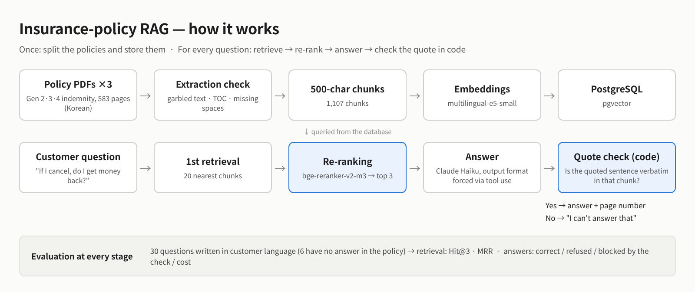
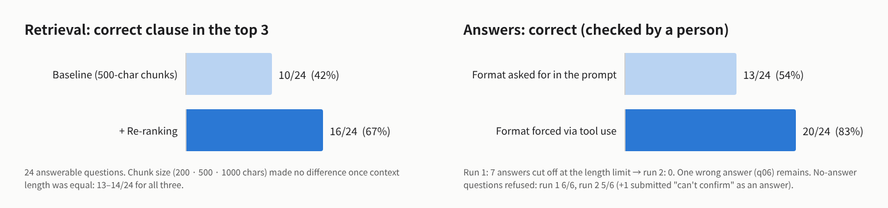
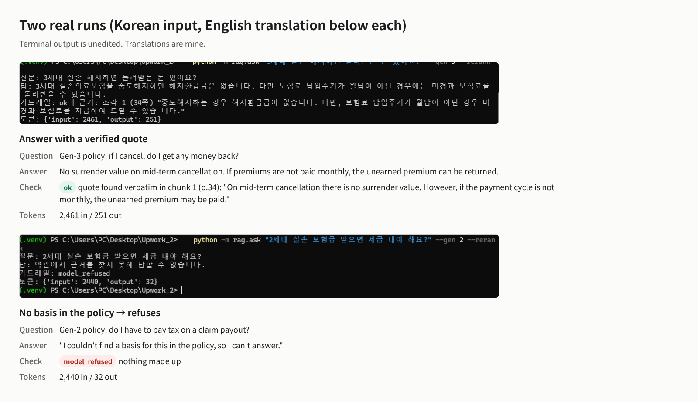
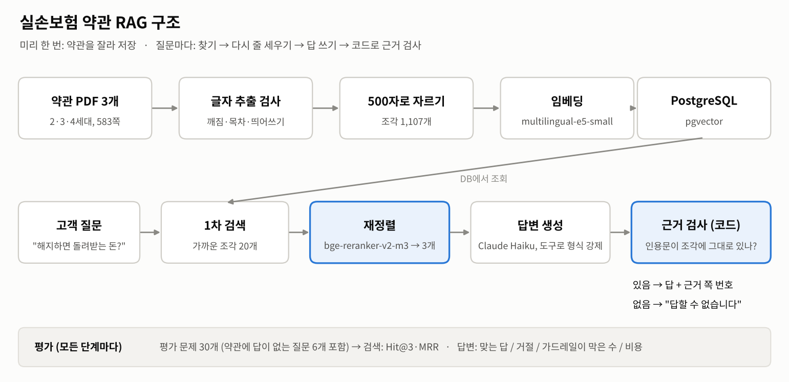
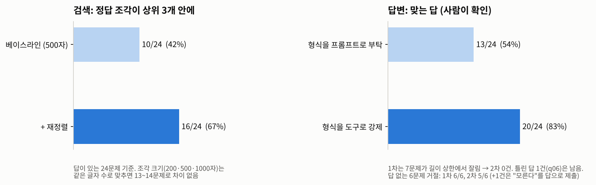
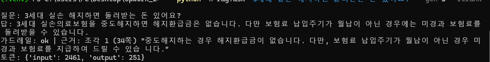
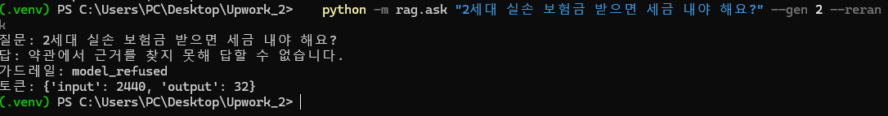
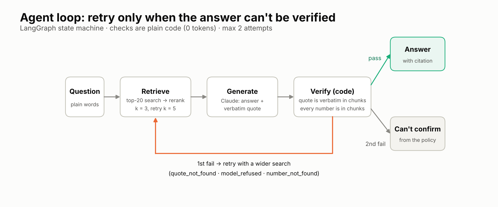
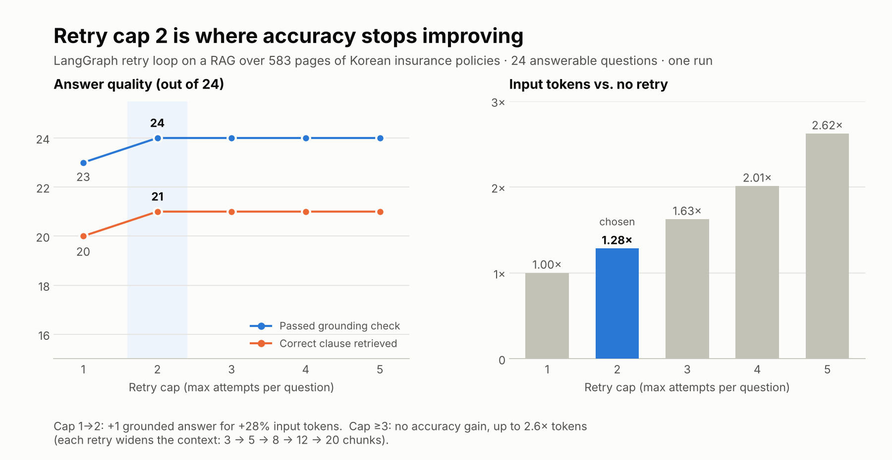
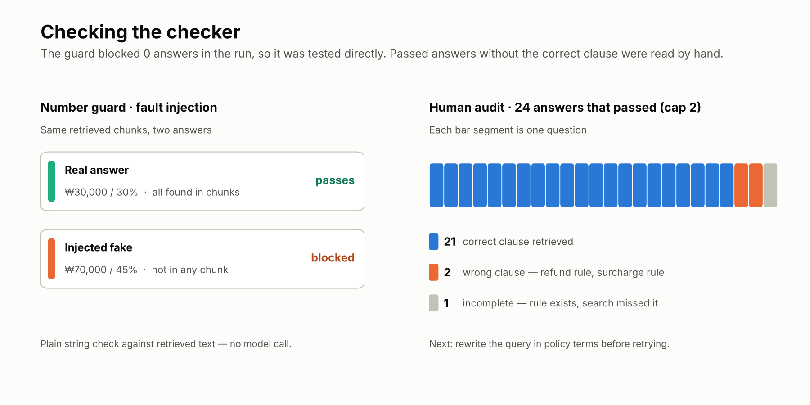

# 실손보험 약관 RAG — 허술한 첫 버전부터 재고, 고친 기록

## English summary

A RAG system over Korean health-insurance policy documents (indemnity policies, generations 2–4, 583 pages). The goal is not a chatbot that "works", but a record of measuring every stage, finding why it fails, and fixing it — starting from a deliberately plain baseline.

### Current results (Nov 2026): 60 answerable questions + 6 with no answer in the policy

| Stage | Result | How |
|---|---|---|
| Retrieval: correct passage in the top 3 | 75.0% (45/60) → **90.0% (54/60)**, 95% CI 79.9–95.3% | candidates from two embedding models (e5-small + bge-m3), the question rewritten into policy terms, both rankings re-ranked and fused. The correct passage is in the candidate pool for 60/60 |
| Answers correct (each answer read and judged) | **86.7% (52/60)** with 3 passages | 4 confidently wrong, 1 incomplete, 3 refused |
| No-answer questions | 6/6 not answered | one reply said "not in the policy, call the support line"; the script counts it as an answer |

**Tried and not adopted** (kept as measured results)
- Giving the model 10 passages instead of 3: correct answers went 52 → 50. More look-alike clauses (covered vs. non-covered care) produced mixed-up answers.
- Cutting by article and labelling every chunk with its location: retrieval 54 → 51, answers 52 → 53. It fixed the confusions it targeted and broke about as many summary-table questions.
- Letting Claude pick the final 3 out of 10: no change in the top-3 rate.

**Read these numbers with care**
- All 60 questions were used for tuning, and the last fusion rule was added after reading the failures. "90%" leans optimistic until it is checked on a held-out set.
- At n = 60, a difference of 2–3 questions cannot be told apart from noise (45 → 52 had McNemar p = 0.12).
- 36 of the 60 questions were drafted with Claude from the clause text and are not fully hand-reviewed. Answers were judged by reading each one with Claude's help; a full re-check by the author is pending.
- Scoring matches one verbatim evidence phrase per question, so a correct passage with different wording counts as a miss.
- Re-ranking went from 9.0 s to 0.4 s per question after replacing the CPU build of torch with the CUDA build (RTX 4060).

### Earlier phase (Oct 2026): 24 questions, one embedding model

The three images and the table below are from this phase. Four evidence labels were corrected afterwards (see "Label correction"), so these figures are not directly comparable with the November ones.







**What was measured** — 30 questions written the way customers ask (6 have no answer in the policy)

| Stage | Before | After | What changed |
|---|---|---|---|
| Retrieval: correct clause in the top 3 (24 answerable questions) | 41.7% (10/24) | 66.7% (16/24) | re-ranking 20 candidates with bge-reranker-v2-m3; MRR 0.295 → 0.569. McNemar p = 0.07: a clear direction, not conclusive at n = 24 |
| Answers correct, checked by a person | 13/24 | 20/24 | output format forced via tool use: truncated answers 7 → 0, output tokens 20,537 → 6,465 |
| No-answer questions refused | 6/6 | 5/6 | one answer said "can't confirm" but was submitted as found — logged, not hidden |

**Findings**
- Chunk size was not the cause. At equal context length (3,000 chars), 200 / 500 / 1,000-char chunks all found 13–14 of 24.
- All 14 baseline misses were retrieval misses: 0 from text extraction, 0 from chunk boundaries.
- Asking in policy vocabulary instead of customer words inflates the score (41.7% → 54.2%), so the eval set uses customer wording.

**Limits at that point**
- 6 questions had no correct chunk in the top 20 — mostly customer words vs. policy words ("money back" vs. "surrender value"). This is what the November work addressed (candidate pool now 60/60).
- The quote check stops made-up quotes, but not a real sentence used the wrong way (1 case, q06).
- Re-ranking took about 13 s per question on CPU (0.4 s on GPU since November).

Answer run for 66 questions: about $0.024 (Claude Haiku). 73 tests (pytest). Updated documents without stale versions, and permission filtering inside retrieval: see the last section.
Stack: Python, PostgreSQL 16 + pgvector, multilingual-e5-small, bge-m3, bge-reranker-v2-m3, Claude API (tool use), pytest, Docker. Run commands: see "실행" below.

---

실손의료보험 약관(2·3·4세대)을 넣고 "내 실손은 몇 세대고, 이 진료는 보장되나"에 답하는 RAG입니다.
목표는 잘 돌아가는 챗봇이 아니라, **검색이 맞는 조항을 가져왔는지 숫자로 재고, 틀린 이유를 단계별로 나눠 고친 과정**을 남기는 것입니다.

> 지금 상태 (2026-11-27): 평가 60문항 기준 검색 Hit@3 90.0%, 답변 정확도 86.7%. 아래 그림 넷은 10월(24문항) 단계의 것입니다.





실행 예시 — 답이 있는 질문 (근거 쪽과 원문 인용이 같이 나옴):



약관에 답이 없는 질문 ('세금 체납' 문단이 있어 헷갈리기 쉬운 함정 질문):



## 2026-11 정확도 개선 (60문항)

평가 문항을 24개에서 60개로 늘렸습니다 (앞쪽 요약표에서 나온 24개 + 약관 조문 본문에서 나온 36개). 약관에 답이 없는 6문항은 따로 셉니다.
시작점 75.0%는 10월 방식(임베딩 모델 하나 + 재정렬)을 같은 60문항으로 잰 값입니다.

| 단계 | 결과 | 비고 |
|---|---|---|
| 검색 Hit@3 | 75.0% (45/60) → 86.7% (52/60) → **90.0% (54/60)** | 95% 신뢰구간 79.9~95.3% · MRR@10 0.704 · Hit@3000자 95.0% · 합친 후보 안에 정답 60/60 |
| 답변 정확도 (답 문장을 하나씩 읽어 판정) | **86.7% (52/60)** | 조각 3개 기준. 자신 있게 틀린 답 4 · 불완전 1 · 거절 3 |
| 답 없는 6문항 | 6/6 답하지 않음 | 1건은 "약관에 안내가 없으니 콜센터로 문의"라고 답해 채점 스크립트는 답한 것으로 셉니다 |

**검색 방식** (`rag/hybrid.py`)

```
질문 ─┬─ 원래 질문 ───┬─ e5-small 상위 20 ─┐
      │               └─ bge-m3   상위 20 ─┴─ 합친 후보 → 재정렬 → 순위 A
      └─ 바꿔 쓴 질문 ─ (같은 과정) ────────────────────────────────→ 순위 B
         (Claude Haiku가 약관 용어로 바꿈)
순위 A + 순위 B (RRF) → 각 순위의 1등을 맨 앞으로 → 거의 같은 조각 제거 → 상위 3
```

**무엇이 점수를 올렸나**
1. **임베딩 모델 두 개의 후보를 합침.** 모델 하나의 상위 20개에는 정답이 없는 문항이 있었고, 합치니 60문항 전부 후보 안에 정답이 들어왔습니다.
2. **원래 질문과 바꿔 쓴 질문의 순위를 합침.** 원래 질문은 요약표 문항에, 약관 용어로 바꿔 쓴 질문은 조문 문항에 강합니다. 한쪽만 쓰면 46/60, 합치면 52/60.
3. **각 순위의 1등은 남김 (52 → 54).** 바꿔 쓴 질문이 뜻을 틀리게 옮기면 원래 질문의 1등이 합친 순위에서 4~5등으로 밀렸습니다. 이 규칙은 틀린 문항을 들여다본 뒤에 넣었습니다.
4. **GPU.** torch가 CPU판으로 깔려 있던 것을 CUDA판으로 바꿔 재정렬이 질문당 9.0초 → 0.4초.

**해 봤지만 채택하지 않은 것**

| 시도 | 결과 |
|---|---|
| 재정렬 후보 20 → 40 | 후보 안 정답은 1개 늘었는데 Hit@3은 떨어짐 (24문항 83.3% → 70.8%). 헷갈리는 조각도 같이 늘어남 |
| 조각을 100자씩 겹치기 | 노린 문항(q18)은 고쳐졌지만 4문항을 잃어 순효과 없음 (p=0.69). 기계적 자르기는 하나만 바꿔도 6~8문항이 흔들림 |
| Claude가 상위 10개 중 3개 고르기 | Hit@3 그대로 (MRR 0.672 → 0.775) |
| 답변 단계에 조각 10개 주기 | 맞는 답 52 → 50. 비슷한 조항이 늘어 급여·비급여를 섞거나 목록의 뜻을 뒤집음 |
| 조문 단위로 자르고 조각마다 위치 이름표 붙이기 (`struct500`, `mixed500`) | 검색 54 → 51, 답변 52 → 53. 노린 문항(급여·비급여 혼동, 잘린 목록)은 고쳐졌지만 요약표 문항이 그만큼 흔들림 |

**답변에서 틀린 8문항 (조각 3개 기준)**
- 자신 있게 틀림 4: 급여·비급여 혼동(q03), 비슷하지만 다른 문장을 근거로 씀(q06), 다른 규칙의 숫자를 인용(q07), 질문이 두 가지로 읽힘(n27)
- 불완전 1: 목록이 조각 경계에서 잘려 "누가"를 못 댐(n07)
- 거절 3: 정답 조각이 상위 3개에 없음(q25, n10, n22)

**이 숫자의 한계**
- 60문항을 전부 튜닝에 썼습니다. 튜닝에 안 쓴 새 문항으로 확인하기 전까지 90%는 낙관적인 쪽입니다.
- 60문항에서는 2~3문항 차이를 우연과 구분할 수 없습니다 (45 → 52는 McNemar p=0.12).
- 새 36문항은 Claude가 조문 본문을 보고 만든 초안이고 전수 검수 전입니다. 답변 판정도 Claude의 도움을 받아 하나씩 읽은 것이라 작성자 전수 검수가 남았습니다.
- 채점은 문항마다 근거 문구 하나가 글자 그대로 들어 있는지를 봅니다. 같은 내용을 다른 문장으로 담은 조각은 오답으로 셉니다.
- 10월 숫자(24문항)는 근거 문구 4개를 고치기 전의 시험지로 잰 것이라 11월 숫자와 직접 비교하지 않습니다.

## 10월 검색 결과 (24문항)

| 버전 | 자르기 | 재정렬 | Hit Rate@3 | MRR@10 | Hit@3000자 | 비고 |
|---|---|---|---|---|---|---|
| baseline500 | 500자 기계적 | 없음 | **41.7%** (10/24) | **0.295** | 54.2% (13/24) | 일부러 허술하게 만든 첫 버전 |
| fixed200 | 200자 기계적 | 없음 | 41.7% | 0.334 | 54.2% (13/24) | 실험 1 |
| fixed1000 | 1000자 기계적 | 없음 | 58.3% | 0.405 | 58.3% (14/24) | 실험 1 |
| **baseline500 + 재정렬** | 500자 기계적 | bge-reranker-v2-m3 | **66.7%** (16/24) | **0.569** | **75.0%** (18/24) | 실험 2 |
| (참고) baseline500, 질문을 약관 단어로 | 500자 기계적 | 없음 | 54.2% (13/24) | 0.361 | - | 통원·비급여·공제 같은 약관 용어로 물었을 때 |

- Hit Rate@3: 정답 조항이 검색 결과 상위 3개 안에 들어온 질문의 비율
- MRR: 정답 조항이 몇 번째에 나왔는지의 역수 평균 (1등이면 1, 2등이면 0.5)
- Hit@3000자: 위에서부터 조각을 이어 붙여 3000자까지 안에 정답이 있는 비율. 조각 크기가 다른 버전끼리는 이걸로 비교합니다
  (1000자 조각 3개는 3000자, 500자 조각 3개는 1500자라서 Hit@3으로 비교하면 큰 조각이 저절로 유리합니다)

**실험 1 결론 — 조각 크기는 원인이 아니었습니다.** Hit@3만 보면 1000자가 41.7% → 58.3%로 크게 오른 것처럼 보이지만,
AI에 넣는 글자 수를 3000자로 맞추면 200·500·1000자 모두 24문제 중 13~14문제로 거의 같습니다.
"작게 자르면 한 조각에 섞이는 내용이 줄어 좋아진다"는 가설은 맞지 않았습니다.

**실험 2 결론 — 재정렬로 Hit@3이 41.7% → 66.7%로 올랐지만, 느립니다.** (24문항에서 McNemar p=0.07: 방향은 뚜렷하지만 이 문항 수로는 확정할 수 없습니다. fixed1000(58.3%)과 비교하면 p=0.73입니다.)
- 1차 검색(임베딩)으로 20개를 가져와 재정렬 모델이 질문과 조각을 함께 읽고 다시 줄 세웁니다. Hit@3 41.7% → 66.7%, MRR 0.295 → 0.569.
- 1차 20개 안에 정답이 있던 문제가 18개였고 재정렬 후 Hit@3000자도 18개 — 재정렬이 올릴 수 있는 만큼은 다 올렸습니다.
- 남은 6문제(q02, q06, q07, q14, q18, q25)는 1차 20개 안에 정답이 없어 재정렬로는 못 고칩니다. 다수가 고객 말과 약관 말의 차이입니다 (예: "교통사고" ↔ "자동차보험", "돌려받는 돈" ↔ "해지환급금").
- 비용: CPU에서 질문당 약 13초 (재정렬 없이는 약 0.4초). 11월에 GPU로 옮긴 뒤로는 재정렬 포함 질문당 0.4초입니다.

## 답변 단계: 근거 검사(가드레일)

흐름: 검색 + 재정렬 상위 3개 조각 → Claude Haiku 5.5가 답과 **원문 인용**을 제출 → 코드가 인용문이 그 조각 안에 글자 그대로 있는지 확인 → 없으면 답을 버리고 "답할 수 없습니다".

### 1차 측정 (30문제, 비용 약 $0.016)

| 답이 있는 24문제 | 건수 | 사람이 확인한 결과 |
|---|---|---|
| 정답 근거를 인용해 답함 | 10 | - |
| 다른 위치의 근거를 인용해 답함 | 4 | 3건은 맞는 답 (요약표 대신 본문 조항을 인용). **1건(q06)은 틀린 답** |
| 정답 조각을 못 찾아와서 거절 | 6 | 검색 단계 실패 |
| 정답 조각이 있는데 거절 | 4 | 4건 모두 답이 길이 상한에서 잘려서 형식이 깨짐 |

| 답이 없는 6문제 | 건수 |
|---|---|
| "답할 수 없습니다"로 거절 | **6 (전부)** — '세금 체납' 문단이 있는 함정 질문(q30)도 거절 |

**배운 것 두 가지**
1. **형식은 부탁하지 말고 강제해야 합니다.** 프롬프트로 "JSON만 출력하라"고 했지만 모델이 앞에 긴 글을 써서 30문제 중 7개가 길이 상한에서 잘렸습니다. 도구(tool use) 스키마로 형식을 강제하도록 바꿨습니다 → 2차 측정 예정.
2. **인용 검사는 '지어낸 인용'은 막지만 '진짜 문장을 잘못 쓴 답'은 못 막습니다.** q06(4세대 해지 시 돌려받는 돈)에서 정답 조각("해지환급금이 발생하지 않습니다")을 못 찾아온 상태로, 약관에 실제로 있는 일반 문장("중도해지시 납입한 보험료보다 환급금이 적을 수 있습니다")을 인용해 "환급금을 받을 수 있다"고 답했습니다. 인용은 진짜라 가드레일을 통과했습니다. 근거 검사만으로는 부족하고, 검색 단계에서 정답 조각을 가져오는 것이 먼저라는 증거입니다.

### 2차 측정: 형식을 도구 스키마로 강제한 뒤 (30문제, 비용 약 $0.011)

| | 1차 (JSON 부탁) | 2차 (도구로 강제) |
|---|---|---|
| 길이 상한에서 잘림 | 7 | **0** |
| 출력 토큰 | 20,537 | **6,465** |
| 답 있는 24문제 중 핵심 답이 맞음 (사람 확인) | 13 | **20** |
| 틀린 답 | 1 (q06) | 1 (q06) |
| 답이 불완전 ("직접 표현은 없다" 등) | 0 | 2 (q07 할증 배수, q18 MRI 두 부위) |
| 거절 | 10 | 1 |
| 답 없는 6문제를 거절 | 6 | 5 + 1 (q10: 답 내용은 "확인할 수 없다"인데 found=true로 제출) |

- 20건 중 1건(q22 약국 공제금액)은 핵심 답(8천원)은 맞지만, 다른 상품 유형의 공제 규칙으로 보이는 문장을 덧붙였습니다. 사람 확인 필요.
- **채점기의 한계**: "근거 맞춤"은 정답 근거 문구가 인용한 조각 안에 있어야 인정합니다. 같은 내용이 요약표와 본문에 둘 다 있어서, 본문을 인용한 맞는 답 6건이 "다른 위치 근거"로 분류됐습니다. 정답 근거를 여러 위치로 등록할 수 있게 고칠 예정입니다.
- **남은 문제**: (1) q06처럼 검색이 정답 조각을 못 가져오면 진짜 문장을 잘못 해석한 답이 가드레일을 통과함 (2) q10처럼 "모른다"는 내용을 found=true로 제출하는 불일치.

## 베이스라인 진단: 놓친 14문제는 어디서 틀렸나

| 단계 | 건수 | 확인 방법 |
|---|---|---|
| 추출 (띄어쓰기 사라짐·글자 중복) | 0 | 정답 문장이 든 조각들이 모두 띄어쓰기 정상(0.3 안팎)인 요약 쪽에 있음 |
| 자르기 (정답 문장이 조각 경계에서 잘림) | 0 | 14문제 모두 정답 문장이 온전히 든 조각이 1개 이상 있음 |
| **검색 (정답 조각이 있는데 순위에서 밀림)** | **14** | 위 두 가지가 아니면 남는 것 |

- 처음 가설은 "500자로 기계적으로 자르면 정답이 경계에서 잘려서 놓친다"였는데, 데이터로 보니 **틀렸습니다.** 잘린 건 0건이었습니다.
- 대신 밀려난 이유로 보이는 것 세 가지 (아직 가설, 실험으로 확인할 것):
  1. **한 조각에 여러 항목이 섞임**: 500자 안에 입원·통원·급여·비급여 자기부담이 한꺼번에 들어 있어, 한 가지를 묻는 질문과의 유사도가 흐려짐
  2. **고객 말과 약관 말의 차이**: 질문만 약관 용어에서 고객 말투로 바꿔도 Hit Rate@3이 54.2% → 41.7%로 떨어짐
  3. **같은 내용이 요약서와 본문에 두 번 있음**: 1등으로 올라온 조각 중 여럿이 띄어쓰기가 사라진 본문 조각 (예: q16 해지 질문에 90쪽 본문)

## 왜 회사별이 아니라 세대별인가

실손의료보험은 2009년 10월부터 보장 기준이 표준화되어, 회사마다 다른 것은 주로 보험료입니다.
반면 판매 시기(세대)에 따라 자기부담 비율과 비급여 보장 방식이 달라서, 실제로 묻는 질문은 "몇 세대냐"에 갈립니다.
그래서 보험사 한 곳의 세대별 약관을 씁니다.

## 데이터

약관 PDF는 리포에 넣지 않습니다. 아래에서 직접 받아 `data/raw/`에 넣으면 됩니다.

- 출처: 삼성화재 공시실 > 상품공시 > 보험상품공시 > 판매중지상품, 상품명 검색 "실손"
- `gen2.pdf`: 무배당 삼성화재 실손의료비보험(1611.7), 판매개시 2016.11.01
- `gen3.pdf`: 무배당 삼성화재 실손의료비보험(1704.1), 2018.10.1 적용판 (3세대 상품의 개정판)
- `gen4.pdf`: 무배당 삼성화재 실손의료비보험(2107.1), 2022.06.23 판 (일반형·계약전환용 등 합본)

## 1일차: 글자 추출 검사 결과

자르기 전에 PDF에서 글자가 제대로 뽑히는지부터 쟀습니다 (`python -m rag.extract_check`).

| 문서 | 페이지 | 정상 | 목차 | 빈 페이지 | 깨짐 | 띄어쓰기 비율 | 굵은 글씨 겹침 흔적 |
|---|---|---|---|---|---|---|---|
| gen2 (2016) | 218 | 195 | 8 | 15 | 0 | 0.119 | 269군데 (98쪽) |
| gen3 (2018) | 242 | 223 | 8 | 11 | 0 | 0.116 | 319군데 (119쪽) |
| gen4 (2022) | 123 | 114 | 2 | 7 | 0 | 0.345 | 0 |

- 글자가 통째로 깨진 페이지는 없었습니다.
- 대신 **2016·2018년 PDF는 띄어쓰기가 대부분 사라져서** 뽑힙니다 (보통 한국어 문장은 0.3 안팎). 예: `회사는피보험자가질병으로인하여병원에입원하여`
- 같은 두 PDF는 **굵은 제목이 글자를 두 번 찍은 방식**이라 `질 질병 병입 입원 원`처럼 뽑힙니다. 조항 제목에 핵심 단어가 있어서 검색에 영향이 있을 수 있습니다.
- 검사기 자체의 실수도 있었습니다: 처음 기준(한글 비율 30%)은 목차 페이지를 "깨짐"으로 잘못 판정했습니다. 점선(`.....`) 때문에 한글 비율이 낮았던 것이라, 목차를 따로 구분하도록 고쳤습니다.
- 베이스라인은 이 문제들을 **일부러 고치지 않고** 그대로 넣습니다 (목차 페이지 포함, 빈 페이지만 제외). 위 문제가 검색 점수를 실제로 얼마나 떨어뜨리는지는 평가 문제로 잰 뒤 하나씩 고칩니다.

베이스라인 결과: 조각 1,107개 (gen2 314 · gen3 360 · gen4 433).

## 구조

```
rag/extract_check.py  PDF 글자 추출 + 페이지별 깨짐 검사 (자르기 전에 추출부터 숫자로 확인)
rag/chunking.py       조각 나누기 (baseline500 = 500자마다 기계적으로)
rag/embed.py          임베딩: intfloat/multilingual-e5-small (무료·로컬, 384차원)
rag/ingest.py         조각 -> 임베딩 -> Postgres(pgvector) 저장, 넣은 수와 DB 수 대조
rag/search.py         질문 -> 가장 가까운 조각 k개 (세대 필터 가능)
rag/rerank.py         재정렬: bge-reranker-v2-m3로 후보를 다시 줄 세움 (점수는 파일에 저장해 다시 씀)
rag/rewrite.py        질문 바꿔 쓰기: 고객 말투 -> 약관 용어 검색어 (Claude Haiku, 결과 저장)
rag/hybrid.py         최종 검색 방식: 모델 두 개 + 질문 두 개 + 재정렬 + 순위 합치기
rag/generate.py       답변 생성(Claude, 도구 스키마로 형식 강제) + 근거 검사(인용문이 조각에 있는지)
rag/ask.py            질문 하나에 답: 최종 검색 방식 -> 생성 -> 근거 검사
rag/evaluate.py       검색 채점: Hit@3, MRR@10, Hit@3000자
rag/evaluate_answers.py  답변 채점: 맞는 답 / 거절 원인 / 가드레일 판정 / 비용
eval/questions.csv    평가 문제 30개 (요약표 문항 24 + 답 없는 문항 6)
eval/questions_v2_draft.csv  평가 문제 36개 (조문 본문 문항, 초안)
eval/confidence.py    신뢰구간(Wilson)과 버전 간 유의성(McNemar)
db/init.sql           chunks 표. method 컬럼으로 버전별 결과를 한 DB에서 비교
```

벡터 색인(HNSW/IVFFlat)은 아직 만들지 않았습니다. 조각이 수천 개 수준이라 전수 비교로 충분한지 먼저 재고 결정합니다.

## 실행 (Windows PowerShell)

Windows용 파이썬(`py` 런처)으로 가상환경을 만듭니다. MSYS2/MINGW 파이썬(`C:\msys64\...`)으로는
torch가 설치되지 않습니다.

```powershell
docker compose up -d
py -m venv .venv
.\.venv\Scripts\Activate.ps1
pip install -r requirements.txt

python -m rag.extract_check          # 1. 글자가 제대로 뽑히는지 검사
python -m rag.ingest --method baseline500   # 2. 자르기 -> 임베딩 -> 저장 (e5-small)
python -m rag.ingest --method baseline500@m3   #    같은 조각을 bge-m3로 한 번 더
python -m rag.search "도수치료는 보장되나요" --gen 4   # 3. 검색
python -m rag.evaluate --hybrid --questions eval/questions.csv eval/questions_v2_draft.csv      # 4. 검색 채점 (60문항)
python -m rag.ask "3세대 실손 해지하면 돌려받는 돈 있어요?" --gen 3   # 5. 답변 (.env에 ANTHROPIC_API_KEY 필요)
python -m rag.evaluate_answers --hybrid --k 3 --questions eval/questions.csv eval/questions_v2_draft.csv   # 6. 답변 채점
python -m pytest -q                  # 테스트
```

## Agent loop (LangGraph): retry only when the answer can't be verified



The plain pipeline answers once: retrieve → generate → check → done. If the check fails, it refuses.
The agent loop gives a failed answer **one more chance with a wider search**, and stops there.

- **Retrieve**: pgvector top-20 → reranker → k chunks (k = 3, retry k = 5)
- **Generate**: Claude returns an answer plus a verbatim quote (tool use)
- **Verify (plain code, 0 tokens)**
  1. the quote appears verbatim in the retrieved chunks (existing check)
  2. **number guard (new)**: every number with a unit in the answer (₩, %, times, days…) appears in the retrieved chunks
- **Retry on**: `quote_not_found`, `model_refused`, `number_not_found`. Format errors stop immediately.

### Choosing the retry cap by experiment, not by guess



One run with cap 5; caps 1–4 are computed by truncating the same trajectories.

| Cap | Passed check (/24) | Correct clause retrieved (/24) | Model calls | Input tokens |
|---|---|---|---|---|
| 1 (no retry) | 23 | 20 | 30 | 73,377 (1.00×) |
| **2** | **24** | **21** | **36** | **94,288 (1.28×)** |
| 3 | 24 | 21 | 41 | 119,244 (1.63×) |
| 4 | 24 | 21 | 45 | 147,619 (2.01×) |
| 5 | 24 | 21 | 49 | 192,471 (2.62×) |

**Decision: cap 2.** Going from 1 to 2 recovered one question for +28% input tokens.
Beyond 2, accuracy did not move while tokens grew to 2.6×, because each retry widens the context.

Example the loop fixed (q24): 1st try with 3 chunks → model refused (correct clause missing) → 2nd try with 5 chunks → correct clause retrieved → passed.

### Checking the checker



- **The number guard blocked 0 answers in the run.** Before trusting that, I tested it directly:
  on the same retrieved chunks, the real answer (₩30,000 / 30%) passes and an injected fake (₩70,000 / 45%) is blocked.
  The 0 meant every number in every answer really was in the retrieved text.
- **Human audit.** Every passed answer whose correct clause was *not* retrieved was read by hand:
  - q06 — wrong clause: answered "you may get a partial refund"; the policy says no surrender value.
  - q07 — wrong clause: quoted the general 25% renewal cap instead of the non-covered-care surcharge tiers.
    The number guard can't catch this: 25% *is* in the policy, just in the wrong rule.
  - q18 — incomplete: said the rule wasn't in the chunks; it exists in the policy but retrieval missed it.
- **Label correction (disclosed).** Four evaluation labels (q02, q14, q17, q25) were paraphrases, not verbatim policy text,
  so the retrieval check marked correct answers as misses. I replaced them with verbatim spans; the original labels are in the git history.
  This changed the scoring of retrieval, not the model's behavior.

### Limitations

- **One run.** Answers vary between runs: cap-1 passed 22/24 in an earlier run and 23/24 in this one.
- **"Passed" is not "verified correct" for all 21.** Only the three failures and the four relabeled questions were read by hand.
- **Widening k can't fix a clause that isn't in the top-20 candidates** (q18). Next: rewrite the question in policy terms before retrying.
- **The number guard checks the whole retrieved text, not the cited clause** (q07). It stops invented numbers, not misapplied ones.

### Reproduce

```bash
python -m agent.eval_retry_cap      # 30 questions, cap 5, saves agent/results/eval_v2_raw.json
python -m agent.rescore             # re-score retrieval against the labels (no model calls)
python -m agent.inject_test         # number guard fault injection (no model calls)
python -m agent.check_number_guard  # number extraction unit check
```

## Document updates and permissions (retrieval layer)

Two failures that show up in real "chat with your documents" apps, each measured next to the broken versions. Demo data: a short synthetic policy (Korean, one clause per chunk), multilingual-e5-small, one run.

### 1. Updated documents: replace, don't append

Policy v1 has 5 clauses. v2 changes 2 clauses and removes 1 (4 clauses). 3 questions ask about the changed or removed rules.

| Method | Chunks | Chunks with old text | Old answer in top 3 | Old answer ranked #1 |
|---|---|---|---|---|
| A. Append (re-upload under a new file name) | 9 | 3 | 3/3 | 2/3 |
| B. Upsert by chunk number | 5 | 1 | 1/3 | 1/3 |
| **C. Replace whole document** | **4** | **0** | **0/3** | **0/3** |

- B is the subtle one: it only fails when the new version is shorter, so the removed clause stays searchable.
- C (`rag/versioning.py`) locks the document, then deletes its chunks, inserts the new ones and checks the count in one transaction. If anything fails it rolls back, so search sees the old version or the new one, never a mix. Tested by injecting a NUL byte (a real PDF-extraction artifact): the insert fails and v1 stays intact.
- Re-uploading the same content is skipped by a content hash (0 duplicates). A permission-only change updates the groups without re-embedding.
- The document key must be the app's document ID, not the uploaded file name. Otherwise a renamed re-upload turns into case A.

### 2. Permissions: filter inside the search, not in the prompt

Public policy (6 clauses, group `public`) plus internal underwriting rules (4 clauses, group `underwriting`). 6 questions asked as a customer (`public`), 3 of them aimed at the internal rules, top 3.

| Method | Questions with internal chunks | Internal chunks leaked | Questions with < 3 results |
|---|---|---|---|
| 1. No filter (prompt-only "don't reveal") | 5/6 | 7 | 0/6 |
| 2. Filter after search | 0/6 | 0 | 5/6 |
| **3. Filter inside search** | **0/6** | **0** | **0/6** |

- With no filter, the internal text is already in the model's input. A prompt rule is the only thing between it and the user.
- Filtering after top-k stops the leak but leaves 5 of 6 questions with fewer than 3 passages: an authorized answer ranked 4th is simply lost.
- `rag/acl.py` puts `allowed_groups && user_groups` in the SQL `WHERE`. Underwriters still get the internal rules (3/3). Revoking the group took effect immediately (0/3): 4 rows updated, no re-embedding.
- Empty groups return nothing (deny by default). Groups must come from the server-side session, never from the request or the question text.

### Limits

- Synthetic 10-clause demo, not the 583-page policies. One run.
- No vector index yet (exact scan), so a filtered query always returns k rows. With an HNSW index, filtering can return fewer; pgvector 0.8+ iterative index scans are needed.

### Reproduce

```bash
python -m rag.demo_reindex          # 1. append vs upsert vs replace
python -m rag.demo_acl              # 2. no filter vs filter after vs filter inside
python -m pytest -q tests           # 73 tests; DB tests are skipped if Postgres is not running
```
