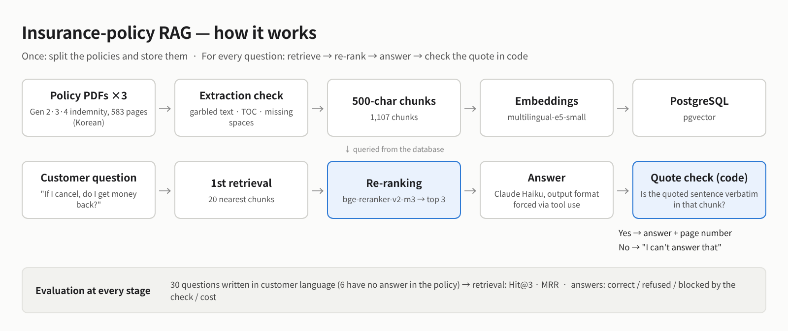
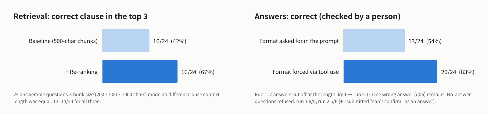
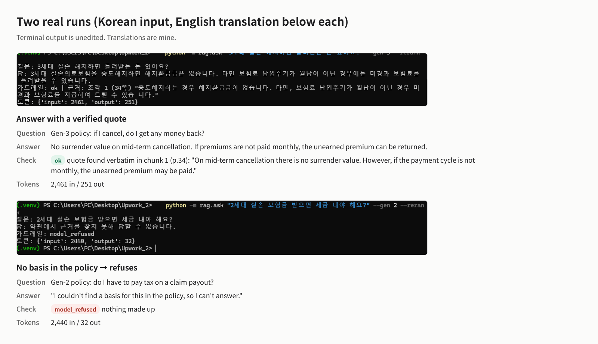
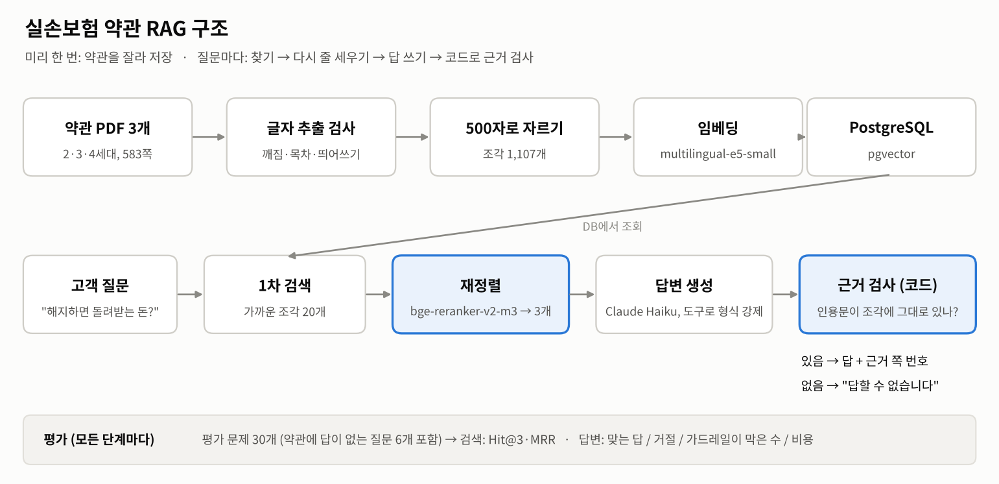
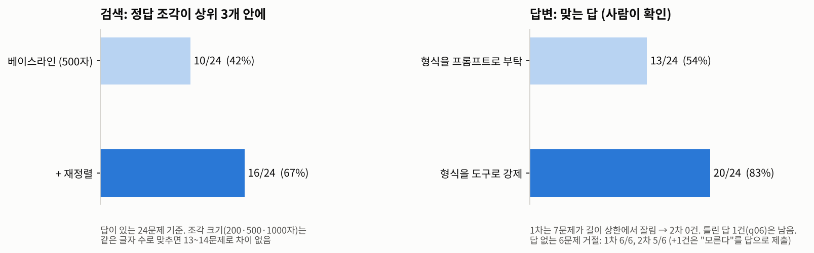
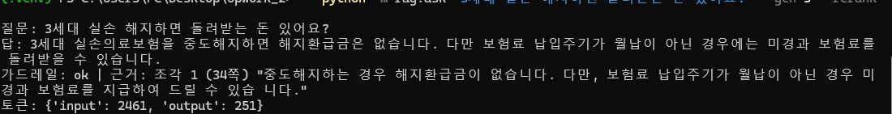
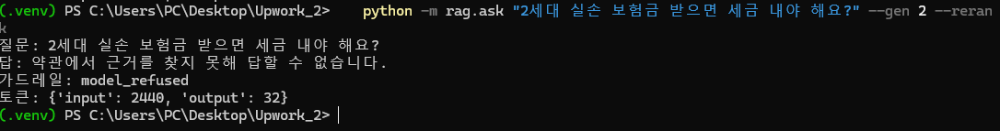

# 실손보험 약관 RAG — 허술한 첫 버전부터 재고, 고친 기록

## English summary

A RAG system over Korean health-insurance policy documents (indemnity policies, generations 2–4, 583 pages). The goal is not a chatbot that "works", but a record of measuring every stage, finding why it fails, and fixing it — starting from a deliberately plain baseline.







**What was measured** — 30 questions written the way customers ask (6 have no answer in the policy)

| Stage | Before | After | What changed |
|---|---|---|---|
| Retrieval: correct clause in the top 3 (24 answerable questions) | 41.7% (10/24) | 66.7% (16/24) | re-ranking 20 candidates with bge-reranker-v2-m3; MRR 0.295 → 0.569 |
| Answers correct, checked by a person | 13/24 | 20/24 | output format forced via tool use: truncated answers 7 → 0, output tokens 20,537 → 6,465 |
| No-answer questions refused | 6/6 | 5/6 | one answer said "can't confirm" but was submitted as found — logged, not hidden |

**Findings**
- Chunk size was not the cause. At equal context length (3,000 chars), 200 / 500 / 1,000-char chunks all found 13–14 of 24.
- All 14 baseline misses were retrieval misses: 0 from text extraction, 0 from chunk boundaries.
- Asking in policy vocabulary instead of customer words inflates the score (41.7% → 54.2%), so the eval set uses customer wording.

**Limits (kept on purpose)**
- 6 questions still have no correct chunk in the top 20 — mostly customer words vs. policy words ("money back" vs. "surrender value"). The next fix is retrieval, not the answer step.
- The quote check stops made-up quotes, but not a real sentence used the wrong way (1 case, q06).
- Re-ranking takes about 13 s per question on CPU.

Answer run for 30 questions: about $0.011 (Claude Haiku). 29 tests (pytest).
Stack: Python, PostgreSQL 16 + pgvector, multilingual-e5-small, bge-reranker-v2-m3, Claude API (tool use), pytest, Docker. Run commands: see "실행" below.

---

실손의료보험 약관(2·3·4세대)을 넣고 "내 실손은 몇 세대고, 이 진료는 보장되나"에 답하는 RAG입니다.
목표는 잘 돌아가는 챗봇이 아니라, **검색이 맞는 조항을 가져왔는지 숫자로 재고, 틀린 이유를 단계별로 나눠 고친 과정**을 남기는 것입니다.

> 지금 상태: 검색(베이스라인 → 진단 → 실험 1·2) 완료, 답변 생성 + 근거 검사 2차 측정 완료.





실행 예시 — 답이 있는 질문 (근거 쪽과 원문 인용이 같이 나옴):



약관에 답이 없는 질문 ('세금 체납' 문단이 있어 헷갈리기 쉬운 함정 질문):



## 검색 결과

| 버전 | 자르기 | 재정렬 | Hit Rate@3 | MRR@10 | Hit@3000자 | 비고 |
|---|---|---|---|---|---|---|
| baseline500 | 500자 기계적 | 없음 | **41.7%** (10/24) | **0.295** | 54.2% (13/24) | 일부러 허술하게 만든 첫 버전 |
| fixed200 | 200자 기계적 | 없음 | 41.7% | 0.334 | 54.2% (13/24) | 실험 1 |
| fixed1000 | 1000자 기계적 | 없음 | 58.3% | 0.405 | 58.3% (14/24) | 실험 1 |
| **baseline500 + 재정렬** | 500자 기계적 | bge-reranker-v2-m3 | **66.7%** (16/24) | **0.569** | **75.0%** (18/24) | 실험 2 |
| (참고) baseline500, 질문을 약관 단어로 | 500자 기계적 | 없음 | 54.2% (13/24) | 0.361 | - | 통원·비급여·공제 같은 약관 용어로 물었을 때 |

- Hit Rate@3: 정답 조항이 검색 결과 상위 3개 안에 들어온 질문의 비율
- MRR: 정답 조항이 몇 번째에 나왔는지의 역수 평균 (1등이면 1, 2등이면 0.5)
- Hit@3000자: 위에서부터 조각을 이어 붙여 3000자까지 안에 정답이 있는 비율. 조각 크기가 다른 버전끼리는 이걸로 비교합니다
  (1000자 조각 3개는 3000자, 500자 조각 3개는 1500자라서 Hit@3으로 비교하면 큰 조각이 저절로 유리합니다)

**실험 1 결론 — 조각 크기는 원인이 아니었습니다.** Hit@3만 보면 1000자가 41.7% → 58.3%로 크게 오른 것처럼 보이지만,
AI에 넣는 글자 수를 3000자로 맞추면 200·500·1000자 모두 24문제 중 13~14문제로 거의 같습니다.
"작게 자르면 한 조각에 섞이는 내용이 줄어 좋아진다"는 가설은 맞지 않았습니다.

**실험 2 결론 — 재정렬로 점수가 거의 두 배가 됐지만, 느립니다.**
- 1차 검색(임베딩)으로 20개를 가져와 재정렬 모델이 질문과 조각을 함께 읽고 다시 줄 세웁니다. Hit@3 41.7% → 66.7%, MRR 0.295 → 0.569.
- 1차 20개 안에 정답이 있던 문제가 18개였고 재정렬 후 Hit@3000자도 18개 — 재정렬이 올릴 수 있는 만큼은 다 올렸습니다.
- 남은 6문제(q02, q06, q07, q14, q18, q25)는 1차 20개 안에 정답이 없어 재정렬로는 못 고칩니다. 다수가 고객 말과 약관 말의 차이입니다 (예: "교통사고" ↔ "자동차보험", "돌려받는 돈" ↔ "해지환급금").
- 비용: CPU에서 질문당 약 13초 (재정렬 없이는 약 0.4초). 실제 서비스라면 GPU나 더 작은 재정렬 모델이 필요합니다.

## 답변 단계: 근거 검사(가드레일)

흐름: 검색 + 재정렬 상위 3개 조각 → Claude Haiku 5.5가 답과 **원문 인용**을 제출 → 코드가 인용문이 그 조각 안에 글자 그대로 있는지 확인 → 없으면 답을 버리고 "답할 수 없습니다".

### 1차 측정 (30문제, 비용 약 $0.016)

| 답이 있는 24문제 | 건수 | 사람이 확인한 결과 |
|---|---|---|
| 정답 근거를 인용해 답함 | 10 | - |
| 다른 위치의 근거를 인용해 답함 | 4 | 3건은 맞는 답 (요약표 대신 본문 조항을 인용). **1건(q06)은 틀린 답** |
| 정답 조각을 못 찾아와서 거절 | 6 | 검색 단계 실패 |
| 정답 조각이 있는데 거절 | 4 | 4건 모두 답이 길이 상한에서 잘려서 형식이 깨짐 |

| 답이 없는 6문제 | 건수 |
|---|---|
| "답할 수 없습니다"로 거절 | **6 (전부)** — '세금 체납' 문단이 있는 함정 질문(q30)도 거절 |

**배운 것 두 가지**
1. **형식은 부탁하지 말고 강제해야 합니다.** 프롬프트로 "JSON만 출력하라"고 했지만 모델이 앞에 긴 글을 써서 30문제 중 7개가 길이 상한에서 잘렸습니다. 도구(tool use) 스키마로 형식을 강제하도록 바꿨습니다 → 2차 측정 예정.
2. **인용 검사는 '지어낸 인용'은 막지만 '진짜 문장을 잘못 쓴 답'은 못 막습니다.** q06(4세대 해지 시 돌려받는 돈)에서 정답 조각("해지환급금이 발생하지 않습니다")을 못 찾아온 상태로, 약관에 실제로 있는 일반 문장("중도해지시 납입한 보험료보다 환급금이 적을 수 있습니다")을 인용해 "환급금을 받을 수 있다"고 답했습니다. 인용은 진짜라 가드레일을 통과했습니다. 근거 검사만으로는 부족하고, 검색 단계에서 정답 조각을 가져오는 것이 먼저라는 증거입니다.

### 2차 측정: 형식을 도구 스키마로 강제한 뒤 (30문제, 비용 약 $0.011)

| | 1차 (JSON 부탁) | 2차 (도구로 강제) |
|---|---|---|
| 길이 상한에서 잘림 | 7 | **0** |
| 출력 토큰 | 20,537 | **6,465** |
| 답 있는 24문제 중 핵심 답이 맞음 (사람 확인) | 13 | **20** |
| 틀린 답 | 1 (q06) | 1 (q06) |
| 답이 불완전 ("직접 표현은 없다" 등) | 0 | 2 (q07 할증 배수, q18 MRI 두 부위) |
| 거절 | 10 | 1 |
| 답 없는 6문제를 거절 | 6 | 5 + 1 (q10: 답 내용은 "확인할 수 없다"인데 found=true로 제출) |

- 20건 중 1건(q22 약국 공제금액)은 핵심 답(8천원)은 맞지만, 다른 상품 유형의 공제 규칙으로 보이는 문장을 덧붙였습니다. 사람 확인 필요.
- **채점기의 한계**: "근거 맞춤"은 정답 근거 문구가 인용한 조각 안에 있어야 인정합니다. 같은 내용이 요약표와 본문에 둘 다 있어서, 본문을 인용한 맞는 답 6건이 "다른 위치 근거"로 분류됐습니다. 정답 근거를 여러 위치로 등록할 수 있게 고칠 예정입니다.
- **남은 문제**: (1) q06처럼 검색이 정답 조각을 못 가져오면 진짜 문장을 잘못 해석한 답이 가드레일을 통과함 (2) q10처럼 "모른다"는 내용을 found=true로 제출하는 불일치.

## 베이스라인 진단: 놓친 14문제는 어디서 틀렸나

| 단계 | 건수 | 확인 방법 |
|---|---|---|
| 추출 (띄어쓰기 사라짐·글자 중복) | 0 | 정답 문장이 든 조각들이 모두 띄어쓰기 정상(0.3 안팎)인 요약 쪽에 있음 |
| 자르기 (정답 문장이 조각 경계에서 잘림) | 0 | 14문제 모두 정답 문장이 온전히 든 조각이 1개 이상 있음 |
| **검색 (정답 조각이 있는데 순위에서 밀림)** | **14** | 위 두 가지가 아니면 남는 것 |

- 처음 가설은 "500자로 기계적으로 자르면 정답이 경계에서 잘려서 놓친다"였는데, 데이터로 보니 **틀렸습니다.** 잘린 건 0건이었습니다.
- 대신 밀려난 이유로 보이는 것 세 가지 (아직 가설, 실험으로 확인할 것):
  1. **한 조각에 여러 항목이 섞임**: 500자 안에 입원·통원·급여·비급여 자기부담이 한꺼번에 들어 있어, 한 가지를 묻는 질문과의 유사도가 흐려짐
  2. **고객 말과 약관 말의 차이**: 질문만 약관 용어에서 고객 말투로 바꿔도 Hit Rate@3이 54.2% → 41.7%로 떨어짐
  3. **같은 내용이 요약서와 본문에 두 번 있음**: 1등으로 올라온 조각 중 여럿이 띄어쓰기가 사라진 본문 조각 (예: q16 해지 질문에 90쪽 본문)

## 왜 회사별이 아니라 세대별인가

실손의료보험은 2009년 10월부터 보장 기준이 표준화되어, 회사마다 다른 것은 주로 보험료입니다.
반면 판매 시기(세대)에 따라 자기부담 비율과 비급여 보장 방식이 달라서, 실제로 묻는 질문은 "몇 세대냐"에 갈립니다.
그래서 보험사 한 곳의 세대별 약관을 씁니다.

## 데이터

약관 PDF는 리포에 넣지 않습니다. 아래에서 직접 받아 `data/raw/`에 넣으면 됩니다.

- 출처: 삼성화재 공시실 > 상품공시 > 보험상품공시 > 판매중지상품, 상품명 검색 "실손"
- `gen2.pdf`: 무배당 삼성화재 실손의료비보험(1611.7), 판매개시 2016.11.01
- `gen3.pdf`: 무배당 삼성화재 실손의료비보험(1704.1), 2018.10.1 적용판 (3세대 상품의 개정판)
- `gen4.pdf`: 무배당 삼성화재 실손의료비보험(2107.1), 2022.06.23 판 (일반형·계약전환용 등 합본)

## 1일차: 글자 추출 검사 결과

자르기 전에 PDF에서 글자가 제대로 뽑히는지부터 쟀습니다 (`python -m rag.extract_check`).

| 문서 | 페이지 | 정상 | 목차 | 빈 페이지 | 깨짐 | 띄어쓰기 비율 | 굵은 글씨 겹침 흔적 |
|---|---|---|---|---|---|---|---|
| gen2 (2016) | 218 | 195 | 8 | 15 | 0 | 0.119 | 269군데 (98쪽) |
| gen3 (2018) | 242 | 223 | 8 | 11 | 0 | 0.116 | 319군데 (119쪽) |
| gen4 (2022) | 123 | 114 | 2 | 7 | 0 | 0.345 | 0 |

- 글자가 통째로 깨진 페이지는 없었습니다.
- 대신 **2016·2018년 PDF는 띄어쓰기가 대부분 사라져서** 뽑힙니다 (보통 한국어 문장은 0.3 안팎). 예: `회사는피보험자가질병으로인하여병원에입원하여`
- 같은 두 PDF는 **굵은 제목이 글자를 두 번 찍은 방식**이라 `질 질병 병입 입원 원`처럼 뽑힙니다. 조항 제목에 핵심 단어가 있어서 검색에 영향이 있을 수 있습니다.
- 검사기 자체의 실수도 있었습니다: 처음 기준(한글 비율 30%)은 목차 페이지를 "깨짐"으로 잘못 판정했습니다. 점선(`.....`) 때문에 한글 비율이 낮았던 것이라, 목차를 따로 구분하도록 고쳤습니다.
- 베이스라인은 이 문제들을 **일부러 고치지 않고** 그대로 넣습니다 (목차 페이지 포함, 빈 페이지만 제외). 위 문제가 검색 점수를 실제로 얼마나 떨어뜨리는지는 평가 문제로 잰 뒤 하나씩 고칩니다.

베이스라인 결과: 조각 1,107개 (gen2 314 · gen3 360 · gen4 433).

## 구조

```
rag/extract_check.py  PDF 글자 추출 + 페이지별 깨짐 검사 (자르기 전에 추출부터 숫자로 확인)
rag/chunking.py       조각 나누기 (baseline500 = 500자마다 기계적으로)
rag/embed.py          임베딩: intfloat/multilingual-e5-small (무료·로컬, 384차원)
rag/ingest.py         조각 -> 임베딩 -> Postgres(pgvector) 저장, 넣은 수와 DB 수 대조
rag/search.py         질문 -> 가장 가까운 조각 k개 (세대 필터 가능)
rag/rerank.py         재정렬: bge-reranker-v2-m3로 1차 20개를 다시 줄 세움
rag/generate.py       답변 생성(Claude, 도구 스키마로 형식 강제) + 근거 검사(인용문이 조각에 있는지)
rag/ask.py            질문 하나에 답: 검색 -> 재정렬 -> 생성 -> 근거 검사
rag/evaluate.py       검색 채점: Hit@3, MRR@10, Hit@3000자
rag/evaluate_answers.py  답변 채점: 맞는 답 / 거절 원인 / 가드레일 판정 / 비용
eval/questions.csv    평가 문제 30개
db/init.sql           chunks 표. method 컬럼으로 버전별 결과를 한 DB에서 비교
```

벡터 색인(HNSW/IVFFlat)은 아직 만들지 않았습니다. 조각이 수천 개 수준이라 전수 비교로 충분한지 먼저 재고 결정합니다.

## 실행 (Windows PowerShell)

Windows용 파이썬(`py` 런처)으로 가상환경을 만듭니다. MSYS2/MINGW 파이썬(`C:\msys64\...`)으로는
torch가 설치되지 않습니다.

```powershell
docker compose up -d
py -m venv .venv
.\.venv\Scripts\Activate.ps1
pip install -r requirements.txt

python -m rag.extract_check          # 1. 글자가 제대로 뽑히는지 검사
python -m rag.ingest --method baseline500   # 2. 자르기 -> 임베딩 -> 저장
python -m rag.search "도수치료는 보장되나요" --gen 4   # 3. 검색
python -m rag.evaluate --method baseline500 --rerank      # 4. 검색 채점
python -m rag.ask "3세대 실손 해지하면 돌려받는 돈 있어요?" --gen 3 --rerank   # 5. 답변 (.env에 ANTHROPIC_API_KEY 필요)
python -m rag.evaluate_answers --rerank                    # 6. 답변 채점
python -m pytest -q                  # 테스트
```
